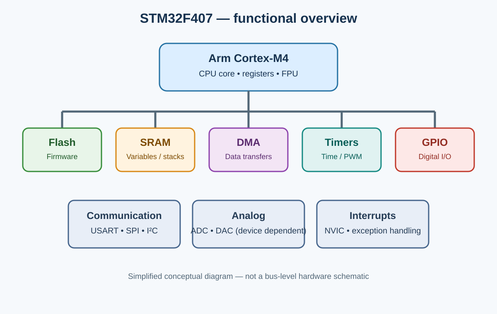

# Лекция 1 / Lesson 1: Знакомство с STM32 / Introduction to STM32

**Платформа / Platform:** STM32F407 · STM32CubeIDE · HAL C  
**Аудитория / Audience:** Знают C, начинают STM32 / C programmers new to STM32  
**Время / Duration:** 60–90 минут / minutes

## Русская версия

### Цели
После лекции слушатель сможет:
- объяснить назначение микроконтроллера;
- различать ядро, память и периферию;
- объяснить роли Flash, SRAM, GPIO, таймеров, UART и DMA;
- описать общий путь от настройки проекта до запуска `main()`.

### 1. Что такое STM32?
STM32 — семейство 32-разрядных микроконтроллеров STMicroelectronics. Внутри одного кристалла находятся процессорное ядро, память и периферийные блоки. STM32F407 использует ядро Arm Cortex-M4 и может работать на частоте до 168 МГц (конкретные характеристики зависят от точной модификации).

### 2. Основные блоки
- **Cortex-M4:** выполняет инструкции программы.
- **Flash:** энергонезависимая память для прошивки и констант.
- **SRAM:** оперативная память для переменных, буферов и стеков.
- **GPIO:** цифровые входы и выходы.
- **Таймеры:** измерение времени, генерация событий и PWM.
- **USART/UART, SPI, I²C:** интерфейсы обмена данными.
- **ADC:** преобразование аналогового напряжения в цифровое значение.
- **DMA:** передача данных между периферией и памятью с меньшим участием CPU.



### 3. Что происходит при запуске?
В типичном проекте после сброса процессор получает начальное значение указателя стека и адрес обработчика сброса из таблицы векторов. Startup-код выполняет раннюю инициализацию, подготавливает секции памяти и передаёт управление `main()`. Детали зависят от startup-файла, линкерного скрипта и конфигурации проекта.

### 4. STM32CubeIDE и HAL
STM32CubeIDE объединяет редактор, сборку и отладку. Встроенный STM32CubeMX помогает настроить выводы, тактирование и периферию и генерирует начальный код. HAL предоставляет функции для типовых операций с периферией.

Пример установки высокого уровня на выводе, предварительно настроенном как выход:

```c
HAL_GPIO_WritePin(GPIOA, GPIO_PIN_5, GPIO_PIN_SET);
```

Этот вызов не настраивает вывод автоматически. GPIO должен быть настроен как выход, а выбранный вывод и внешняя цепь должны соответствовать вашей плате.

### 5. Практическое задание
1. Создайте проект для точной модели STM32F407 в STM32CubeIDE.
2. Найдите `HAL_Init()`, `SystemClock_Config()` и `main()`.
3. В Pinout & Configuration найдите раздел GPIO.
4. Соберите пустой проект.
5. Запишите модель платы и версию STM32CubeIDE.

### Контрольные вопросы
1. Чем Flash отличается от SRAM?
2. Для чего нужен DMA?
3. Какова роль GPIO?
4. Что делают STM32CubeMX и HAL?
5. Почему нельзя считать, что PA5 всегда подключён к светодиоду?

### Вывод
STM32 — это не только CPU: программа управляет памятью и периферией микроконтроллера. Следующая лекция посвящена созданию проекта и настройке GPIO.

---

## English version

### Learning objectives
By the end of this lesson, learners should be able to:
- explain what a microcontroller does;
- distinguish the CPU core, memory, and peripherals;
- describe Flash, SRAM, GPIO, timers, UART, and DMA;
- outline the path from project configuration to `main()`.

### 1. What is STM32?
STM32 is a family of 32-bit microcontrollers from STMicroelectronics. A single chip integrates a CPU core, memory, and peripheral blocks. STM32F407 devices use an Arm Cortex-M4 core and can run at up to 168 MHz; exact specifications depend on the part number.

### 2. Main blocks
- **Cortex-M4:** executes program instructions.
- **Flash:** non-volatile storage for firmware and constants.
- **SRAM:** runtime storage for variables, buffers, and stacks.
- **GPIO:** digital input/output.
- **Timers:** time measurement, event generation, and PWM.
- **USART/UART, SPI, I²C:** communication interfaces.
- **ADC:** converts analog voltage into a digital value.
- **DMA:** transfers data between peripherals and memory with less CPU involvement.


### 3. What happens at startup?
In a typical project, after reset the processor obtains the initial stack pointer and reset-handler address from the vector table. Startup code performs early initialization, prepares memory sections, and transfers control to `main()`. Details depend on the startup file, linker script, and project configuration.

### 4. STM32CubeIDE and HAL
STM32CubeIDE combines code editing, building, and debugging. STM32CubeMX helps configure pins, clocks, and peripherals and generates initialization code. HAL provides functions for common peripheral operations.

Example: set a previously configured output pin high.

```c
HAL_GPIO_WritePin(GPIOA, GPIO_PIN_5, GPIO_PIN_SET);
```

This call does not configure the pin by itself. Configure the GPIO as an output and verify the pin assignment and external circuit for your specific board.

### 5. Practical exercise
1. Create a project for your exact STM32F407 part in STM32CubeIDE.
2. Locate `HAL_Init()`, `SystemClock_Config()`, and `main()`.
3. Find GPIO settings in Pinout & Configuration.
4. Build the empty project.
5. Record your board model and STM32CubeIDE version.

### Review questions
1. How does Flash differ from SRAM?
2. Why is DMA useful?
3. What is GPIO used for?
4. What do STM32CubeMX and HAL do?
5. Why is PA5 not guaranteed to be connected to an LED on every board?

### Summary
STM32 is more than a CPU: firmware coordinates memory and on-chip peripherals. The next lesson covers project creation and GPIO configuration.
